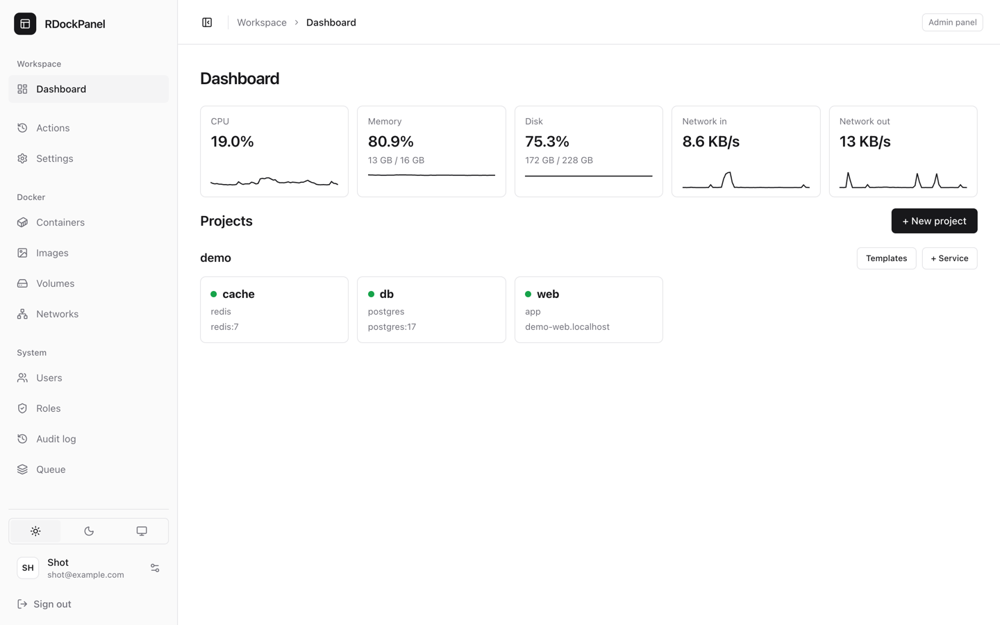
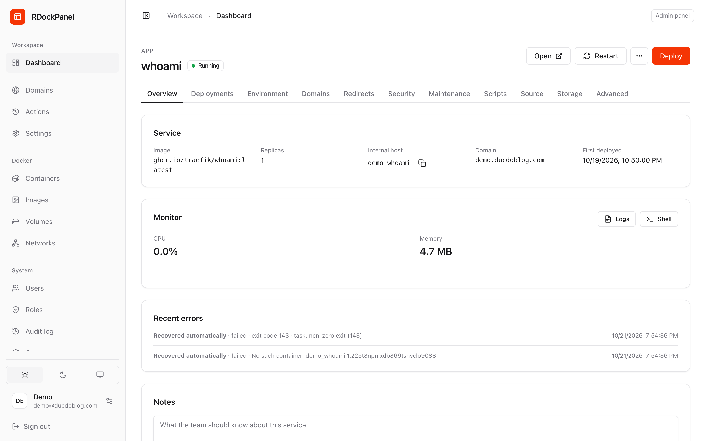
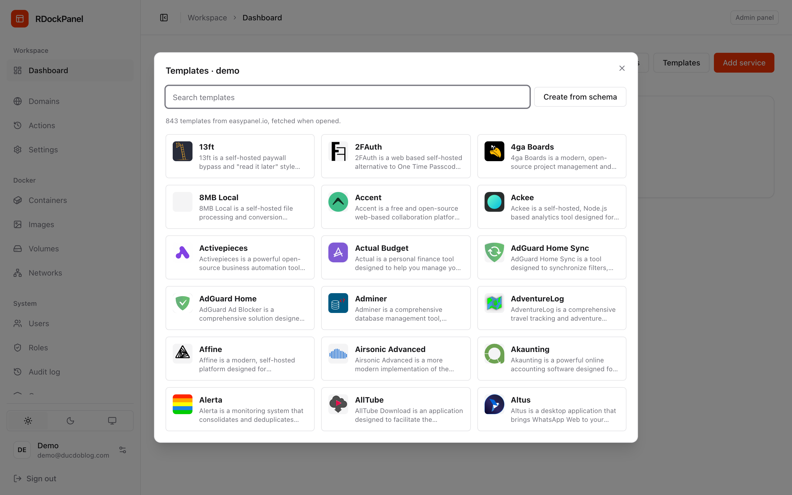
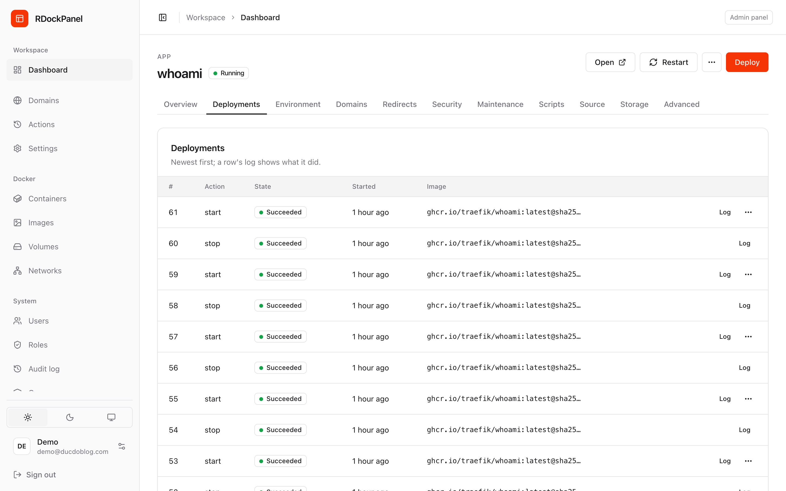
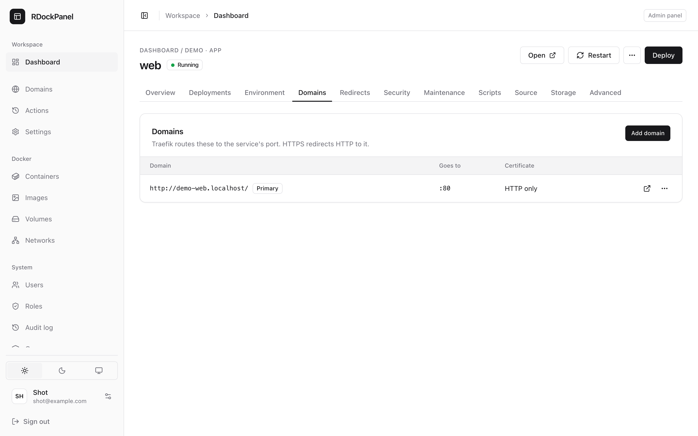
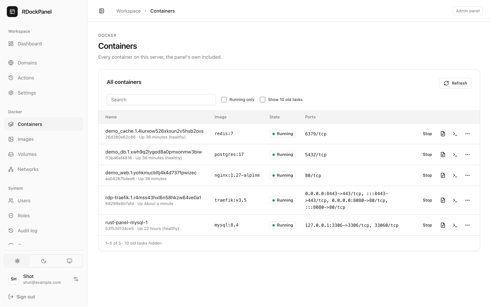
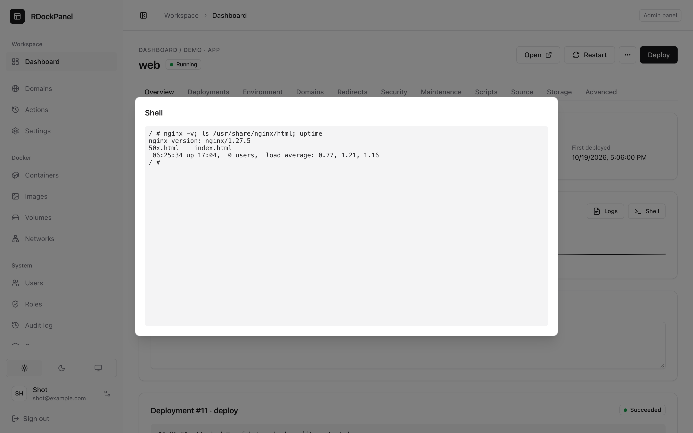

# RDockPanel

**A free, self-hosted server panel, built in Rust.**
Watch your server, manage Docker, and deploy apps to Docker Swarm with domains and HTTPS. Every
feature is free: no project limits, no paid tiers.

[Tiếng Việt](README.vi.md) · [**User guide**](https://irisvn.github.io/RDockPanel/) · [Features](docs/features.md) · [Docs](#documentation) · [Roadmap](docs/roadmap.md)

> **Status: early development.** Try it on a test server first.



## Overview

- **Server and Docker**: live CPU, memory, disk and network; containers (logs, stats, a terminal in
  the browser), images, volumes and networks.
- **Apps on Docker Swarm**: projects and services with rolling deploys, rollback and live logs;
  builds from Git or a Dockerfile; Compose services; **800+ app templates** and one-click databases
  (PostgreSQL, MySQL, MariaDB, MongoDB, Redis).
- **Bring in what already runs**: a container (or a Compose project) started with `docker run` or
  `docker compose` becomes a service, with a plan, a copy of its data and an undo
  ([docs/import.md](docs/import.md)).
- **Domains and HTTPS** through Traefik (Let's Encrypt, your own certificates, Cloudflare Tunnel),
  redirects, rate limits, basic auth and a maintenance page, applied when saved.
- **Operations**: scheduled backups (local or S3), notifications (Discord, Slack, Telegram, email,
  webhooks), a firewall, one-click panel updates, users, roles and project members, a public API.
- English and Vietnamese, light and dark.

Everything in detail: [docs/features.md](docs/features.md).

| A service | Templates | Deployments |
|---|---|---|
|  |  |  |
| Domains | Containers | Terminal |
|  |  |  |

## Quick start (production)

On a fresh Ubuntu or Debian server (amd64 or arm64):

```sh
curl -fsSL https://raw.githubusercontent.com/irisvn/rdockpanel/main/install/install.sh \
  | sudo sh -s -- --admin-email you@example.com
```

On a Mac with Apple silicon, with [OrbStack](https://orbstack.dev) or Docker Desktop running (as
yourself, **without `sudo`**), then open http://localhost:3000/admin:

```sh
curl -fsSL https://raw.githubusercontent.com/irisvn/rdockpanel/main/install/install.sh \
  | sh -s -- --admin-email you@example.com
```

- Add `--domain panel.example.com --email you@example.com` for the panel on HTTPS (Let's Encrypt),
  and `--apps-domain apps.example.com` for generated app domains.
- The panel keeps its data in MySQL 8.4 (the default) or SQLite (`--database mysql|sqlite`).
- Add `--version X.Y.Z` to install a release (Settings → Version can then update it).
- On a Mac, the panel runs in Docker's VM: no Firewall or Reboot there.

Options, upgrades, backups and macOS: [docs/install.md](docs/install.md).

## Quick start (development)

You need Rust (stable) and Docker (Docker Desktop or OrbStack on macOS).

**1. Install the RustCMS CLI first.** RDockPanel is a [RustCMS](https://github.com/irisvn/RustCMS)
application: every `rustcms …` command below comes from it.

```sh
curl -fsSL https://irisvn.github.io/RustCMS/install.sh | sh
export PATH="$HOME/.rustcms/bin:$PATH"   # or add this line to ~/.zshrc
rustcms --version
```

**2. Run the panel.**

```sh
git clone https://github.com/irisvn/rdockpanel && cd rdockpanel
cp .env.example .env && rustcms key:generate    # APP_KEY
docker compose up -d                            # MySQL 8.4 on 127.0.0.1:3306
rustcms migrate
rustcms permission:sync
rustcms make:user --email admin@example.com --name Admin --super-admin
sh scripts/dev-swarm.sh                         # a one-node Swarm, Traefik on :8080 and :8443
rustcms serve                                   # http://localhost:8000/admin
```

- No MySQL? Set `DATABASE_URL=sqlite://storage/panel.sqlite?mode=rwc` in `.env` and skip
  `docker compose up -d`.
- Open the panel at `localhost`, not `127.0.0.1`: sign-in checks the origin.
- The panel manages **the real containers on your machine**, and `dev-swarm.sh` makes it a Swarm
  manager (`docker swarm leave --force` undoes it).

Tests, conventions and the front end: [docs/development.md](docs/development.md).

## Documentation

| | |
|---|---|
| [Features](docs/features.md) | everything the panel does |
| [Install](docs/install.md) | the installer, upgrades, backups, macOS |
| [Development](docs/development.md) | environment, tests, conventions |
| [Architecture](docs/architecture.md) | how it is built: RustCMS, bollard, Swarm, Traefik |
| [Import](docs/import.md) | bringing existing containers into a project |
| [Permissions](docs/permissions.md) | who can see and do what |
| [Security](docs/security.md) | the Docker socket, protected objects, the terminal, CSP |
| [Firewall](docs/firewall.md) | the default-deny firewall |
| [API](docs/api.md) | the panel's JSON, event-stream and WebSocket routes |
| [UI guidelines](docs/ui-guidelines.md) | the design rules every page follows |
| [Roadmap](docs/roadmap.md) | what comes next |

## License

Licensed under either of [Apache License, Version 2.0](LICENSE-APACHE) or [MIT license](LICENSE-MIT),
at your option. xterm.js is MIT-licensed ([its license](resources/admin/js/rdockpanel/vendor/LICENSE-xterm)).
