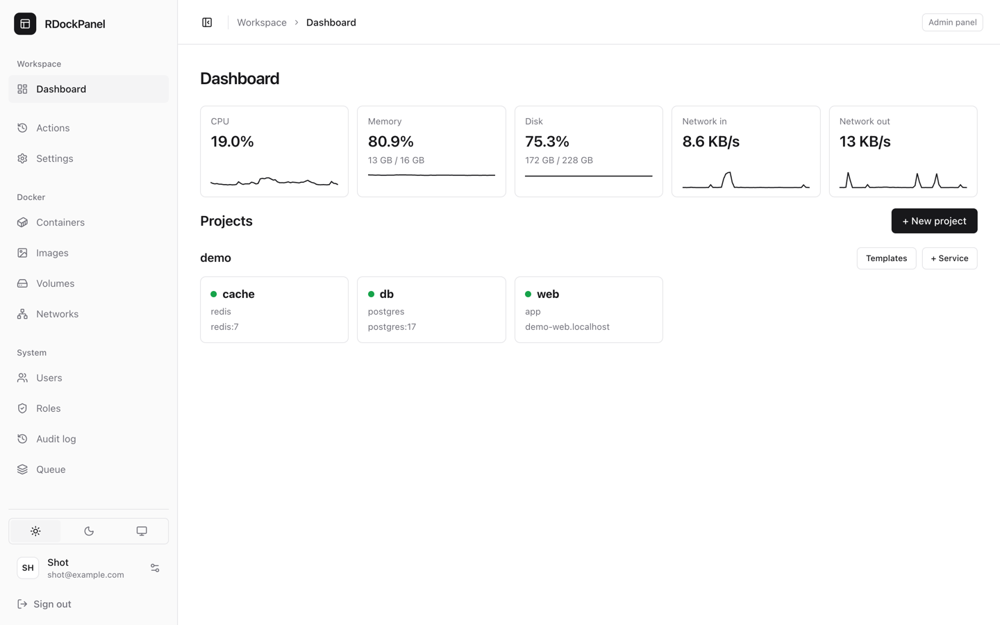
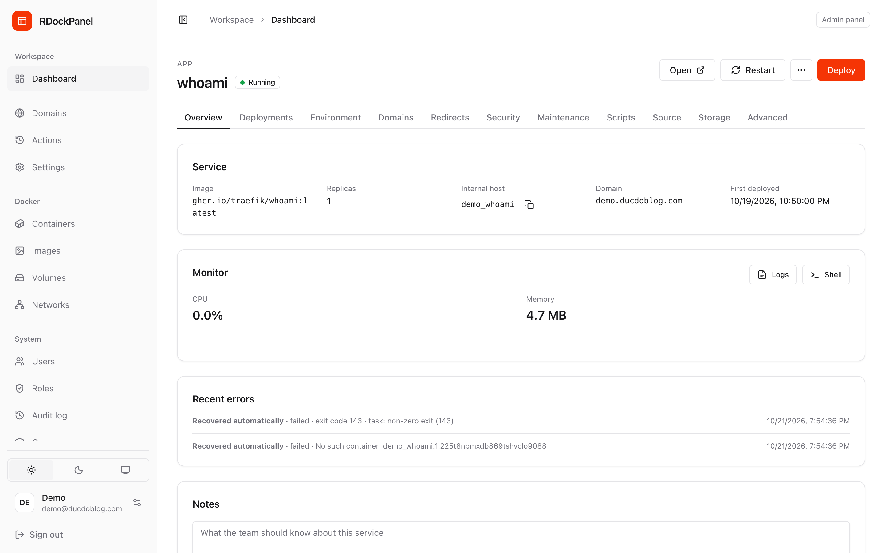
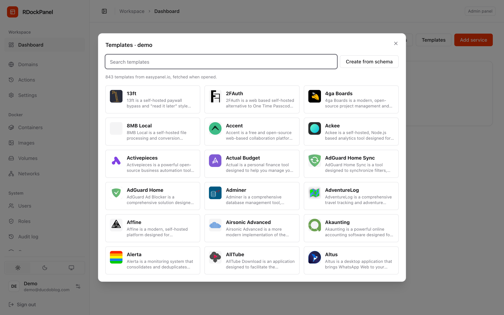
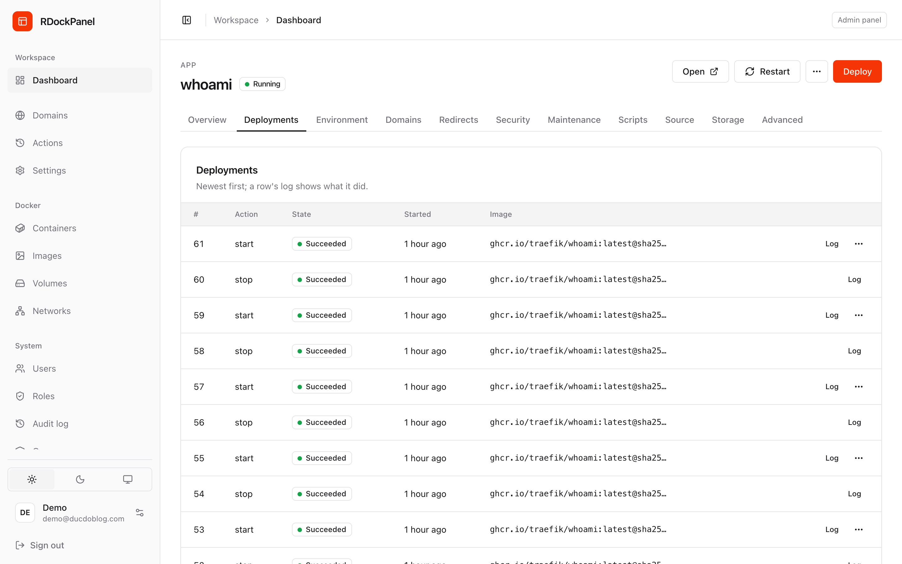
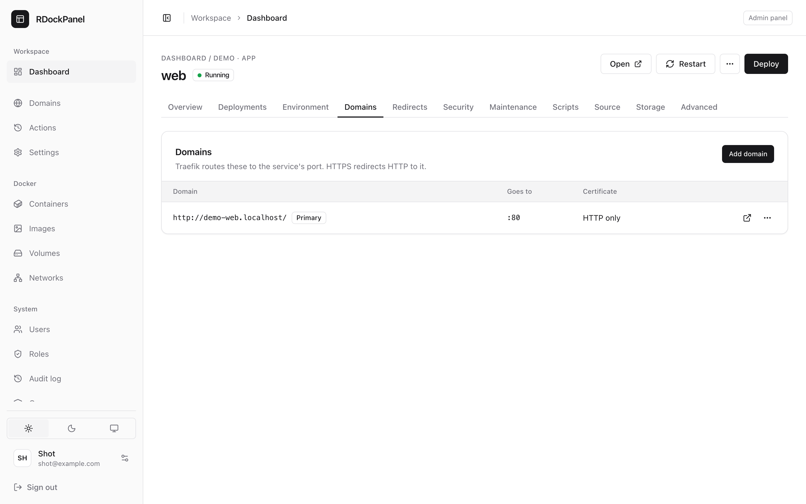
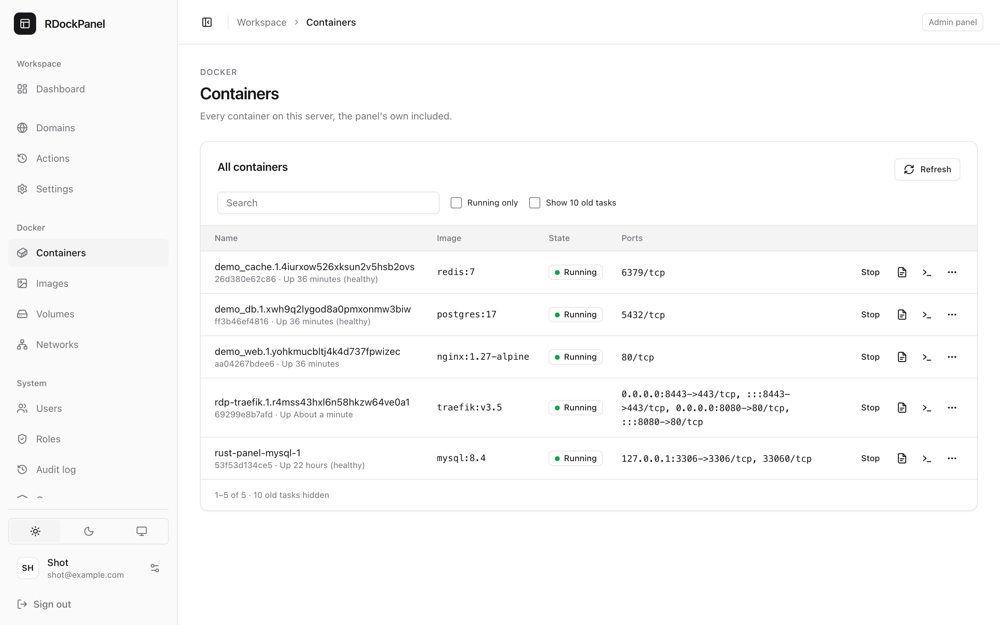
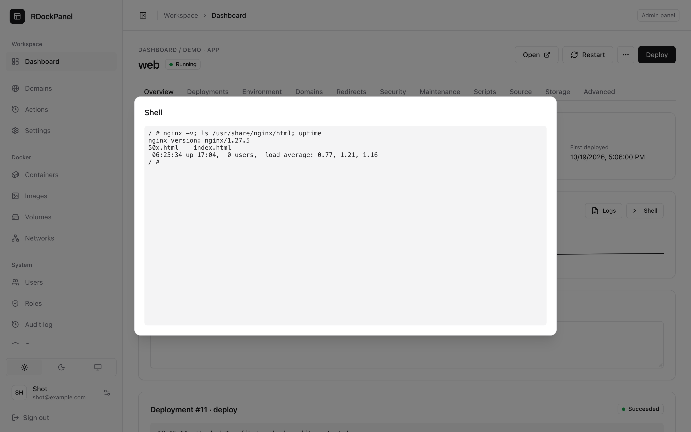

# RDockPanel

**Panel quản trị server tự host, miễn phí, viết bằng Rust.**
Theo dõi server, quản lý Docker, và deploy app lên Docker Swarm kèm domain và HTTPS. Mọi tính năng
đều miễn phí: không giới hạn số project, không có gói trả phí.

[English](README.md) · [Tính năng](docs/features.vi.md) · [Tài liệu](#tài-liệu-tiếng-anh) · [Lộ trình](docs/roadmap.md)

> **Trạng thái: giai đoạn đầu phát triển.** Hãy thử trên một server test trước.



## Tổng quan

- **Server và Docker:** CPU, RAM, ổ đĩa, network trực tiếp; container (log, tài nguyên, terminal
  trên trình duyệt), image, volume và network.
- **App trên Docker Swarm:** project và service với rolling deploy, rollback, log trực tiếp; build
  từ Git hoặc Dockerfile; service Compose; **hơn 800 template** và database một cú bấm
  (PostgreSQL, MySQL, MariaDB, MongoDB, Redis).
- **Domain và HTTPS** qua Traefik (Let's Encrypt, chứng chỉ riêng, Cloudflare Tunnel), chuyển
  hướng, giới hạn request, basic auth và trang bảo trì, áp dụng ngay khi lưu.
- **Vận hành:** backup theo lịch (thư mục trên server hoặc S3), thông báo (Discord, Slack, Telegram,
  email, webhook), tường lửa, cập nhật panel một cú bấm, người dùng, vai trò, thành viên project, API
  công khai.
- Tiếng Anh và tiếng Việt, giao diện sáng và tối.

Chi tiết từng tính năng: [docs/features.vi.md](docs/features.vi.md).

| Trang service | Template | Lịch sử deploy |
|---|---|---|
|  |  |  |
| Domain | Container | Terminal |
|  |  |  |

## Cài nhanh (production)

Trên một server Ubuntu hoặc Debian mới (amd64 hoặc arm64):

```sh
curl -fsSL https://raw.githubusercontent.com/irisvn/rdockpanel/main/install/install.sh \
  | sudo sh -s -- --admin-email ban@example.com
```

Trên máy Mac chip Apple đang chạy [OrbStack](https://orbstack.dev) hoặc Docker Desktop (chạy bằng
user của bạn, **không dùng `sudo`**), rồi mở http://localhost:3000/admin:

```sh
curl -fsSL https://raw.githubusercontent.com/irisvn/rdockpanel/main/install/install.sh \
  | sh -s -- --admin-email ban@example.com
```

- Thêm `--domain panel.example.com --email ban@example.com` để panel chạy HTTPS (Let's Encrypt), và
  `--apps-domain apps.example.com` để có domain tự sinh cho app.
- Dữ liệu của panel nằm trong MySQL 8.4 (mặc định) hoặc SQLite (`--database mysql|sqlite`).
- Thêm `--version X.Y.Z` để cài một bản phát hành (khi đó Settings → Phiên bản cập nhật được).
- Trên Mac, panel chạy trong máy ảo của Docker: không có Tường lửa và Reboot.

Các tuỳ chọn, cách nâng cấp, backup và macOS: [docs/install.md](docs/install.md).

## Chạy thử (môi trường dev)

Cần có Rust (bản stable) và Docker (Docker Desktop hoặc OrbStack trên macOS).

**1. Cài RustCMS CLI trước.** RDockPanel là một ứng dụng [RustCMS](https://github.com/irisvn/RustCMS):
mọi lệnh `rustcms …` bên dưới đều cần CLI này.

```sh
curl -fsSL https://irisvn.github.io/RustCMS/install.sh | sh
export PATH="$HOME/.rustcms/bin:$PATH"   # hoặc thêm dòng này vào ~/.zshrc
rustcms --version
```

**2. Chạy panel.**

```sh
git clone https://github.com/irisvn/rdockpanel && cd rdockpanel
cp .env.example .env && rustcms key:generate    # tạo APP_KEY
docker compose up -d                            # MySQL 8.4 tại 127.0.0.1:3306
rustcms migrate
rustcms permission:sync
rustcms make:user --email admin@example.com --name Admin --super-admin
sh scripts/dev-swarm.sh                         # Swarm một node, Traefik ở :8080 và :8443
rustcms serve                                   # http://localhost:8000/admin
```

- Không muốn dùng MySQL? Đặt `DATABASE_URL=sqlite://storage/panel.sqlite?mode=rwc` trong `.env`
  và bỏ qua `docker compose up -d`.
- Mở panel bằng `localhost`, không dùng `127.0.0.1`: đăng nhập có kiểm tra origin.
- Panel quản lý **các container thật trên máy bạn**, và `dev-swarm.sh` biến Docker trên máy thành
  Swarm manager (gỡ bằng `docker swarm leave --force`).

Test, quy ước và phần giao diện: [docs/development.md](docs/development.md).

## Tài liệu (tiếng Anh)

| | |
|---|---|
| [Tính năng](docs/features.vi.md) | mọi thứ panel làm được (có bản tiếng Việt) |
| [Cài đặt](docs/install.md) | installer, nâng cấp, backup, macOS |
| [Phát triển](docs/development.md) | môi trường, test, quy ước |
| [Kiến trúc](docs/architecture.md) | cách xây dựng: RustCMS, bollard, Swarm, Traefik |
| [Phân quyền](docs/permissions.md) | ai được xem và làm gì |
| [Bảo mật](docs/security.md) | Docker socket, object được bảo vệ, terminal, CSP |
| [Tường lửa](docs/firewall.md) | tường lửa chặn mặc định |
| [API](docs/api.md) | các route JSON, event stream và WebSocket của panel |
| [Quy tắc giao diện](docs/ui-guidelines.md) | bộ quy tắc thiết kế mọi trang phải theo |
| [Lộ trình](docs/roadmap.md) | những gì sắp làm |

## License

Dùng theo một trong hai license tuỳ chọn: [Apache License 2.0](LICENSE-APACHE) hoặc [MIT](LICENSE-MIT).
xterm.js dùng license MIT ([xem tại đây](resources/admin/js/rdockpanel/vendor/LICENSE-xterm)).
